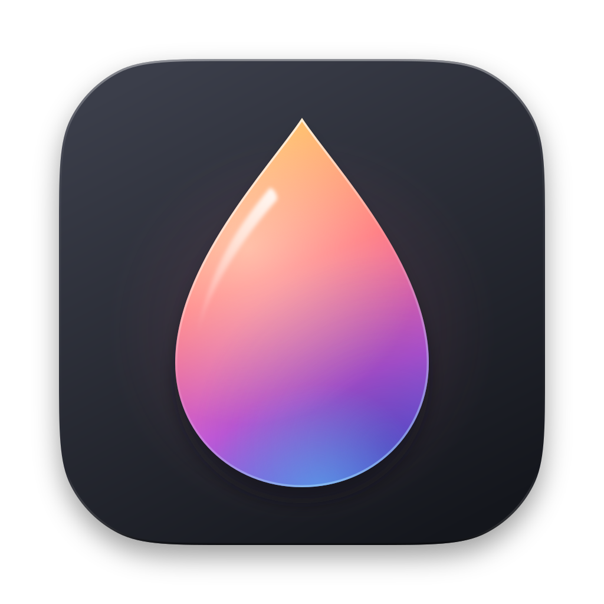

<p align="center">
  
</p>

<h1 align="center">Dipo</h1>

<p align="center"><strong>A local-first color picker for macOS.</strong></p>

<p align="center">
  English | <a href="README.zh-Hans.md">简体中文</a> | <a href="README.zh-Hant.md">繁體中文</a>
</p>

Dipo is a focused color picker for macOS. It is built for quick, repeated use, with no account or cloud sync.

## Features

- Pick from a frozen, magnified screen view; use the arrow keys to move one captured pixel at a time.
- Copy HEX, CSS RGB, or CSS HSL in sRGB, or P3 HEX or CSS P3 in Display P3, with a configurable global pick shortcut.
- Edit in RGB, HSB, or HSL, including opacity.
- Check text/background contrast against WCAG AA thresholds.
- Keep the 20 most recent colors and a separate local favorites list; the menu bar icon lists the recent ones too.
- Choose in Settings whether Dipo opens at login, shows its menu bar icon and Dock icon (one of them always stays), and copies a color right after a pick.

## Install

Download the disk image for your Mac from the [latest release](https://github.com/hy-shine/dipo/releases/latest), `macos-arm64` for Apple silicon or `macos-x64` for Intel, open it, and drag Dipo into Applications. It needs macOS 14 or later. A `.sha256` file next to each disk image holds its checksum. Dipo is not notarized, so see [Permissions](#permissions) for the first launch. Once installed, **Settings → About → Check Now** looks for a newer version.

## Quick start

### Requirements

- macOS 14 or later
- An Apple silicon or Intel Mac
- Go 1.27.3 or later
- Xcode Command Line Tools for the Swift screen picker

### Build and run

```sh
make run
```

`make run` builds and launches Dipo. To build without launching it, run `make build`; the app is placed under `build/nsgo/`.

The build bundles the native screen picker. The app is signed ad hoc unless `CODESIGN_IDENTITY` names a code signing identity in your keychain, for example `make run CODESIGN_IDENTITY="<identity name>"`. Keeping one stable identity avoids re-granting Screen Recording after each rebuild.

## Use

1. Select **Pick**, or use the global shortcut (default `Ctrl+Alt+C`; `Control+Option+C` on macOS). Click a pixel to pick it; press Esc or right-click to cancel. The color is copied in the selected format unless **Copy After Picking** is off in Settings.
2. Use **Copy** for the selected format. Recent and favorite colors can be copied by clicking them.
3. Switch between **Contrast**, **Recent**, and **Favorites** below the editor. Recent colors show a count and can be cleared without deleting favorites.
4. Open **Settings** (the top-right gear, or `⌘,`) for login, menu bar, Dock, copy and shortcut options. To change the pick shortcut, click its field and press the new combination; the button beside it restores the default. Under **About**, **Check Now** looks for a newer version.

### Color spaces

HEX, RGB, and HSL are sRGB, as CSS and most web tools read them. Mac displays show Display P3, and some pickers report the display's P3 values, so the same pixel can give other numbers there; choose **P3 HEX** to compare. A pick that sRGB cannot show is marked **Outside sRGB** beside the current color: its sRGB values are the nearest sRGB color, and the Display P3 formats keep it as the screen showed it.

### Permissions

Dipo is not notarized, so macOS may block it on first launch. Try opening it, then allow it in **System Settings → Privacy & Security → Open Anyway**. If the app is installed in `/Applications` and you trust this copy, you can remove the quarantine attribute from Terminal:

```sh
sudo xattr -rd com.apple.quarantine /Applications/Dipo.app
```

If you installed Dipo elsewhere, use that location instead. Only do this for a copy you built or trust. Removing quarantine does not grant Screen Recording access.

The first pick needs macOS Screen Recording permission. Dipo uses the captured frame only for that pick; it is not written to history or uploaded. If access is missing, open the top-right gear and use **Check again** or **Open System Settings**.

## Development

```sh
make check
make check-ui
```

`make check` runs the native picker checks, `go vet`, and Go tests. `make check-ui` runs the NSGo macOS interface tests and saves screenshots under `.nsgo/test/screenshots/macos/`.

## Project layout

| Path | Purpose |
| --- | --- |
| `main.go`, `panel.go`, `settings.go` | NSGo app, main window, and settings window |
| `sampler.go`, `native/` | Go-to-Swift screen picker bridge and macOS capture view |
| `internal/colour/` | Color parsing, formatting, models, and contrast calculations |
| `internal/library/` | Local preferences and recent/favorite color persistence |
| `locales/` | English, Simplified Chinese, and Traditional Chinese catalogs |
| `resources/` | App and menu-bar icons plus the built picker helper |
| `nsgo.yaml`, `Makefile` | App id, version and update key; build, check and release commands |
| `.github/workflows/` | CI for every push, and the release for a version tag |

The app is built with [NSGo](https://github.com/nsgo-dev/nsgo).

## License

Released under the [MIT License](LICENSE).
