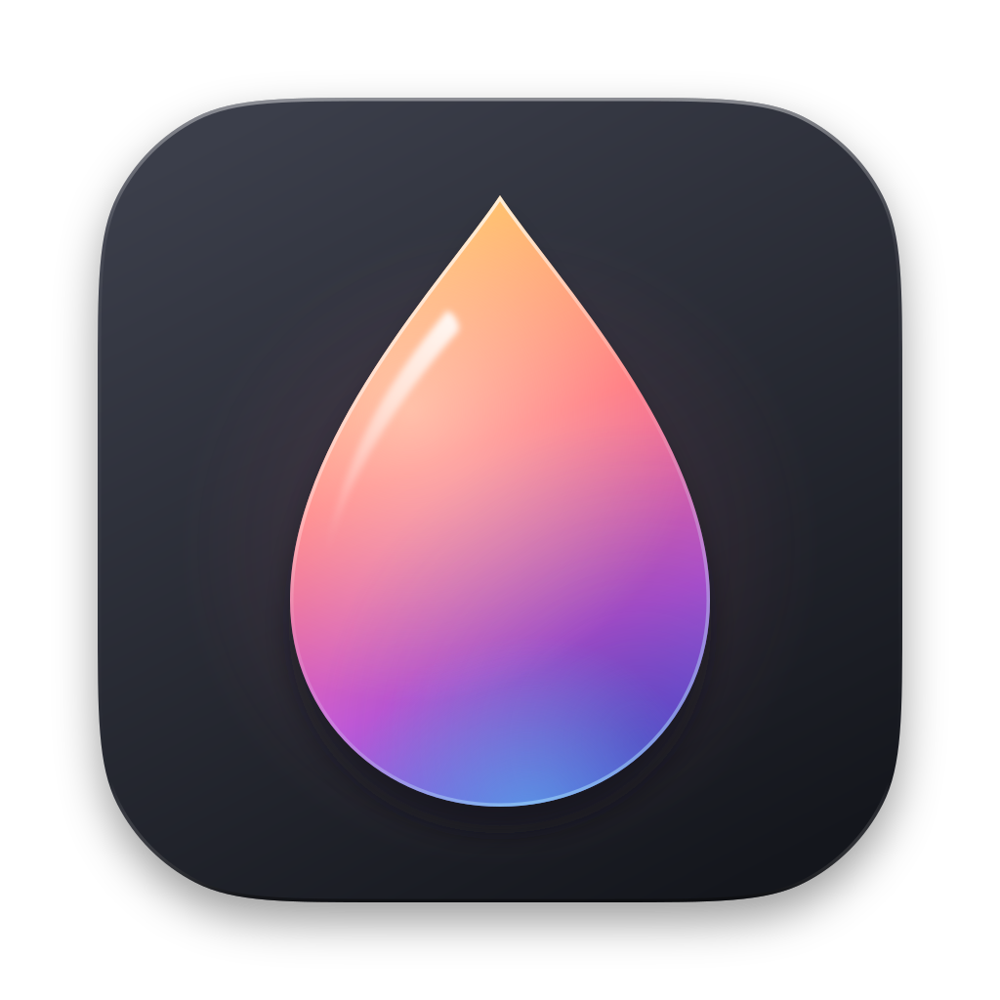

<p align="center">
  
</p>

<h1 align="center">Dipo</h1>

<p align="center"><strong>一个本地优先的 macOS 取色器。</strong></p>

<p align="center"><a href="README.md">English</a> | 简体中文 | <a href="README.zh-Hant.md">繁體中文</a></p>

Dipo 是一个专注于取色的 macOS 取色器。它面向快速、重复的使用场景，不包含账号或云同步。

## 功能

- 在冻结并放大的屏幕画面中取色；使用方向键逐像素移动。
- 复制 HEX、CSS RGB 或 CSS HSL，并可配置全局取色快捷键。
- 使用 RGB、HSB 或 HSL 调色，并调整不透明度。
- 按 WCAG AA 标准检查文字与背景的对比度。
- 在本机保存最近 20 个颜色和独立的收藏列表。
- 在设置中选择是否登录时打开、是否显示菜单栏图标，以及取色后是否立即复制。

## 安装

从[最新发布](https://github.com/hy-shine/dipo/releases/latest)下载磁盘映像，打开后把 Dipo 拖进“应用程序”文件夹。需要 macOS 14 或更高版本，发布的是 Apple silicon 版本。磁盘映像旁的 `.sha256` 文件是它的校验和。Dipo 未经公证，首次启动请参见[权限](#权限)。安装后，可在 **设置 → 关于 → 立即检查** 中查看新版本。

## 快速开始

### 环境要求

- macOS 14 或更高版本
- 当前构建配置面向 Apple silicon
- Go 1.27.3 或更高版本
- Xcode Command Line Tools，用于编译 Swift 取色器

### 构建与运行

```sh
make run
```

`make run` 会构建并启动 Dipo。若只需构建而不启动，运行 `make build`；应用会生成在 `build/nsgo/` 下。

构建会将原生取色器打包进去。默认使用 ad hoc 签名；若 `CODESIGN_IDENTITY` 指定了钥匙串中的代码签名身份，则使用该身份，例如 `make run CODESIGN_IDENTITY="<身份名称>"`。保持同一签名身份，避免每次重新构建后再次要求屏幕录制权限。

## 使用

1. 点击 **取色**，或使用全局快捷键（默认 `Ctrl+Alt+C`，在 macOS 上即 `Control+Option+C`）。点击像素确认取色；按 Esc 或右键取消。除非在设置中关闭 **取色后自动复制**，颜色会按当前选择的格式复制。
2. 点击 **复制**，复制当前选择的格式。最近记录和收藏中的颜色也可点击复制。
3. 在编辑器下方切换 **对比度**、**最近** 和 **收藏**。最近记录会显示数量，并可单独清除，不会删除收藏。
4. 打开 **设置**（右上角齿轮，或 `⌘,`），调整登录、菜单栏、复制和快捷键选项。在 **关于** 中点击 **立即检查**，查看是否有新版本。

### 权限

Dipo 未经公证，macOS 可能在首次启动时阻止它。先尝试打开一次，然后在 **系统设置 → 隐私与安全性 → 仍要打开** 中放行。如果应用安装在 `/Applications`，且你信任该副本，可在终端移除隔离属性：

```sh
sudo xattr -rd com.apple.quarantine /Applications/Dipo.app
```

如果 Dipo 安装在其他位置，请改为该实际路径。仅对你构建或信任的副本执行此操作；移除隔离属性不会授予屏幕录制权限。

首次取色需要 macOS 屏幕录制权限。Dipo 只在本次取色中使用截取画面，不会写入历史或上传。若没有权限，请打开右上角齿轮，并使用 **重新检查** 或 **打开系统设置**。

## 开发

```sh
make check
make check-ui
```

`make check` 运行原生取色器检查、`go vet` 和 Go 测试。`make check-ui` 运行 NSGo 的 macOS 界面测试，截图保存在 `.nsgo/test/screenshots/macos/`。

## 项目结构

| 路径 | 用途 |
| --- | --- |
| `main.go`、`panel.go`、`settings.go` | NSGo 应用、主窗口和设置窗口 |
| `sampler.go`、`native/` | Go 与 Swift 取色器之间的桥接及 macOS 截取视图 |
| `internal/colour/` | 颜色解析、格式化、模型和对比度计算 |
| `internal/library/` | 本地偏好设置及最近/收藏颜色的持久化 |
| `locales/` | 英文、简体中文和繁体中文文案 |
| `resources/` | 应用图标、菜单栏图标和构建后的取色器 helper |
| `nsgo.yaml`、`Makefile` | 应用 ID、版本和更新公钥；构建、检查和发布命令 |
| `.github/workflows/` | 每次推送的 CI，以及版本标签触发的发布 |

应用使用 [NSGo](https://github.com/nsgo-dev/nsgo) 构建。

## 许可证

本项目采用 [MIT 许可证](LICENSE)。
