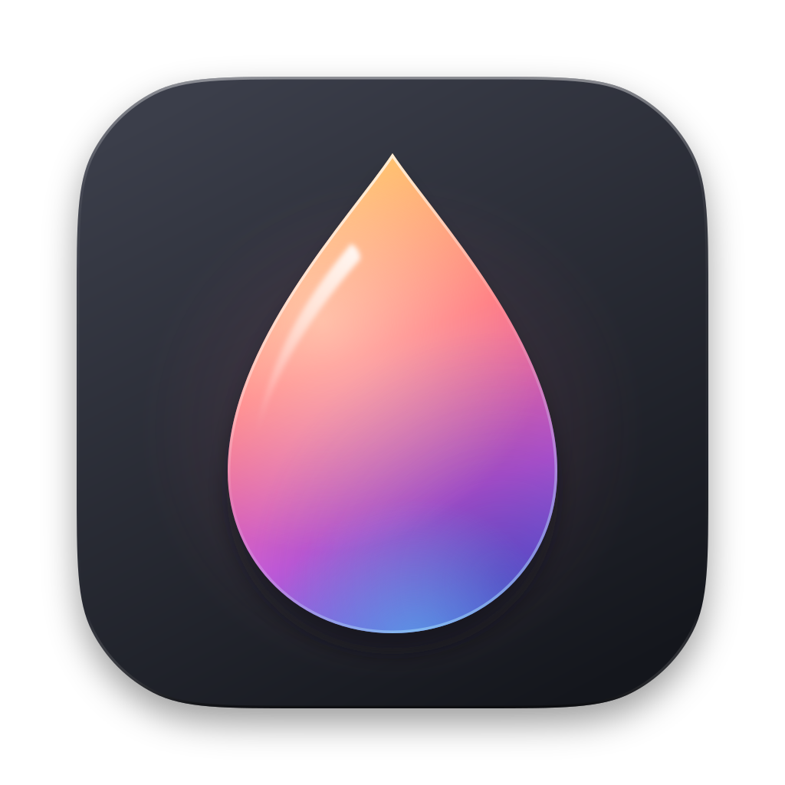

<p align="center">
  
</p>

<h1 align="center">Dipo</h1>

<p align="center"><strong>一個本機優先的 macOS 取色器。</strong></p>

<p align="center"><a href="README.md">English</a> | <a href="README.zh-Hans.md">简体中文</a> | 繁體中文</p>

Dipo 是一個專注於取色的 macOS 取色器。它面向快速、重複的使用情境，不包含帳號或雲端同步。

## 功能

- 在凍結並放大的螢幕畫面中取色；使用方向鍵逐像素移動。
- 複製 HEX、CSS RGB 或 CSS HSL，並可設定全域取色快速鍵。
- 使用 RGB、HSB 或 HSL 調色，並調整不透明度。
- 依 WCAG AA 標準檢查文字與背景的對比度。
- 在本機保存最近 20 個顏色和獨立的收藏清單。
- 在設定中選擇是否登入時打開、是否顯示選單列圖示，以及取色後是否立即複製。

## 快速開始

### 環境需求

- macOS 14 或以上版本
- 目前建置設定以 Apple silicon 為目標
- Go 1.27.3 或以上版本
- Xcode Command Line Tools，用於編譯 Swift 取色器

### 建置與執行

```sh
make run
```

`make run` 會建置並啟動 Dipo。若只需建置而不啟動，執行 `make build`；應用程式會產生在 `build/nsgo/` 下。

建置會將原生取色器一併打包。預設使用 ad hoc 簽署；若 `CODESIGN_IDENTITY` 指定了鑰匙圈中的程式碼簽署身分，則使用該身分，例如 `make run CODESIGN_IDENTITY="<身分名稱>"`。保持同一簽署身分，避免每次重新建置後再次要求螢幕錄製權限。

## 使用

1. 點擊 **取色**，或使用全域快速鍵（預設 `Ctrl+Alt+C`，在 macOS 上即 `Control+Option+C`）。點擊像素確認取色；按 Esc 或右鍵取消。除非在設定中關閉 **取色後自動複製**，顏色會依目前選擇的格式複製。
2. 點擊 **複製**，複製目前選擇的格式。最近紀錄和收藏中的顏色也可點擊複製。
3. 在編輯器下方切換 **對比度**、**最近** 和 **收藏**。最近紀錄會顯示數量，並可單獨清除，不會刪除收藏。
4. 打開 **設定**（右上角齒輪，或 `⌘,`），調整登入、選單列、複製和快速鍵選項。在 **關於** 中點擊 **立即檢查**，查看是否有新版本。

### 權限

Dipo 未經公證，macOS 可能在第一次啟動時阻擋它。先嘗試開啟一次，然後在 **系統設定 → 隱私權與安全性 → 仍要打開** 中允許。如果應用程式安裝在 `/Applications`，且你信任此副本，可在終端機移除隔離屬性：

```sh
sudo xattr -rd com.apple.quarantine /Applications/Dipo.app
```

如果 Dipo 安裝在其他位置，請改為該實際路徑。僅對你建置或信任的副本執行此操作；移除隔離屬性不會授予螢幕錄製權限。

第一次取色需要 macOS 螢幕錄製權限。Dipo 只在本次取色中使用擷取畫面，不會寫入紀錄或上傳。若沒有權限，請開啟右上角齒輪，並使用 **重新檢查** 或 **開啟系統設定**。

## 開發

```sh
make check
make check-ui
```

`make check` 執行原生取色器檢查、`go vet` 和 Go 測試。`make check-ui` 執行 NSGo 的 macOS 介面測試，截圖保存在 `.nsgo/test/screenshots/macos/`。

## 專案結構

| 路徑 | 用途 |
| --- | --- |
| `main.go`、`panel.go`、`settings.go` | NSGo 應用程式、主視窗和設定視窗 |
| `sampler.go`、`native/` | Go 與 Swift 取色器之間的橋接及 macOS 擷取畫面 |
| `internal/colour/` | 顏色解析、格式化、模型和對比度計算 |
| `internal/library/` | 本機偏好設定及最近/收藏顏色的保存 |
| `locales/` | 英文、簡體中文和繁體中文文案 |
| `resources/` | 應用程式圖示、選單列圖示和建置後的取色器 helper |
| `nsgo.yaml`、`Makefile` | 應用程式 ID、版本和更新公鑰；建置、檢查和發布指令 |
| `.github/workflows/` | 每次推送的 CI，以及版本標籤觸發的發布 |

應用程式使用 [NSGo](https://github.com/nsgo-dev/nsgo) 建置。

## 授權

本專案採用 [MIT 授權條款](LICENSE)。
